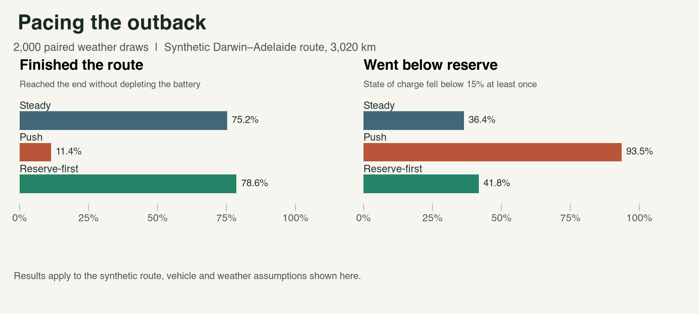

# Solar race Monte Carlo

Should a solar car hold its pace or back off when its battery reserve starts falling? This project puts three pacing rules through the same weather draws on a simplified 3,020 km Darwin–Adelaide route. The C++ simulator calls [Solar ECM](https://github.com/YashIsACoder/solar-ecm-cpp) for traction demand and solar generation. A Python script summarises the paired trials.

I adapted this project from the Monte Carlo race-strategy work I did with **Sunswift Racing**. This standalone implementation uses a 2025 Bridgestone World Solar Challenge–inspired route and synthetic vehicle, terrain and weather inputs. See [the route notes](data/README.md) and [model assumptions](docs/model.md).



## What the example shows

In the 2,000-trial example, reserve-first finished **1,573** trials and steady finished **1,505**. Across their 1,448 joint finishes, reserve-first cut the median paired driving time by **109.8 minutes**. It also crossed the 15% reserve more often, **41.8% vs 36.4%**. A fixed 92 km/h target was the quickest among its own finishers and completed only **228** trials. This is the trade-off the experiment is meant to expose.

Results above used seed `2025`, a 5.5 kWh synthetic pack, and an Apple Clang 17 / libc++ build. Identical runs on the same build are reproducible. The standard library's normal distribution can produce different draws across toolchains. See the [full example statistics](docs/outback-results.md).

## Run it

Put the two checkouts next to each other, or pass `-DSOLAR_ECM_SOURCE_DIR=/path/to/solar-ecm-cpp`. The build also accepts an installed ECM package via `CMAKE_PREFIX_PATH`.

```sh
cmake -S . -B build -DCMAKE_BUILD_TYPE=Release
cmake --build build --parallel
ctest --test-dir build --output-on-failure

mkdir -p runs
./build/solar-race --route data/outback-2025-style.csv --trials 2000 --seed 2025 \
  > runs/outback-2025.csv
python3 analysis/analyse.py runs/outback-2025.csv
```

There is one CSV row for each trial and policy, including completion, distance, driving time, minimum and final state of charge, electrical demand, solar generation and surplus lost when the pack was full. To check capacity sensitivity on the same weather seed, run the command again with `--pack-kwh 4.5` or `--pack-kwh 6.5`.

The analysis uses the Python standard library. Redrawing the checked-in figure is optional and uses base R:

```sh
Rscript --vanilla analysis/plot.R runs/outback-2025.csv docs/outback-pacing.png \
  'Synthetic Darwin–Adelaide route, 3,020 km'
```

## Inside the simulator

| Code | Responsibility |
| --- | --- |
| `src/route.cpp` | Read and validate the route fixture. |
| `src/race.cpp` | Sample day and leg conditions, choose pace, call the ECM and update storage. |
| `src/main.cpp` | Run each policy on the same trial and emit CSV. |
| `analysis/analyse.py` | Compare completion and reserve use, and pair driving times on common finishes. |

Tests exercise the C++ library integration, deterministic draws, storage conservation, depletion midway through a leg, a hard pace cap, and the CLI.
