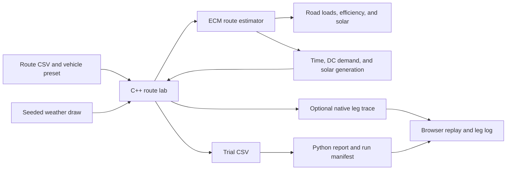

# System design

ECM computes energy from vehicle parameters and driving conditions. The route
lab chooses speeds and updates battery state using that energy. Python consumes
completed experiments as CSV and computes paired comparisons.

## Components

| Location | Role |
| --- | --- |
| `include/ecm`, `src/core` | Vehicle inputs, force calculations, efficiency maps, segment energy, and solar |
| `include/ecm_cont`, `src/continuous` | Continuous drive cycles, integration, and route estimator adapters |
| `src/detail` | Shared internal validation and unit conventions |
| `bindings/python` | pybind11 bindings for the C++ library |
| `include/ecm/lab.hpp`, `include/ecm/forecast.hpp`, `src/lab` | Route parser, scheduled policy engine, weather calibration and paired Monte Carlo driver |
| `apps/route-lab` | Command-line client, Python analysis, local browser adapter and standalone replay assets |
| `tests` | Native model tests, Python binding tests, and an installed-package consumer |

`ECM::ecm_cont` links `ECM::ecm`. The bindings and the lab both use the
library, so force and energy calculations live in one place. `ECM::lab`
adds seeded weather and a streaming result sink on top of the estimators.
Native and wheel builds use the same CMake targets. Native installation
exports the headers and CMake targets, and the wheel ships the extension
plus package metadata.

## Simulation flow

1. Parse each route leg into distance, fractional grade, irradiance and cruise cap. Select the vehicle preset and ECM backend.
2. Select baseline or posterior weather, and precompute any route energy envelope once. Draw weather and optional showers once per trial and pass them to all policies. [Forecast model](../apps/route-lab/docs/forecast.md) · [Pacing algorithm](../apps/route-lab/docs/pacing.md)
3. Call the selected estimator with the state-independent inputs for each candidate pace. It returns seconds, signed DC demand and solar generation. Reuse the chosen estimate for the battery update.
4. Apply capacity, reserve, depletion and optional control schedules in the lab. Emit one CSV row per trial and pacing rule.
5. Run the same seed across vehicle and model cases. Python validates trial IDs, pairs equivalent rows, and records the input and executable hashes.

The library uses metres, seconds, m/s, fractional grade and watt-hours at the
route boundary. The legacy `stint()` interfaces return joules. The lab
converts the route inputs from kilometres, km/h and percentage grade before
calling ECM. The sign convention is positive DC demand and positive solar
generation, with net draw equal to demand minus generation.

The CLI streams results and keeps one trial's weather and battery state in
memory. Posterior mode also retains a fixed four-chain calibration for the
experiment. Runtime grows with the number of trials, policies, legs and estimator
work. The experiment runner retains parsed cases for pairing. Seeded results
are repeatable on the same build. Standard-library normal draws can differ
across toolchains.

The local browser adapter runs the CLI with bounded trial counts and sends the
same results and one native leg trace to the frontend. The browser interpolates
the cars' positions and battery charge between native leg observations, using
the native race clock for starts, control holds and overnight parking. Weather
readouts switch as the selected strategy enters each leg. The map includes
expandable configuration and per-leg telemetry. The separate analytics page
uses the same run and race time. A tab can reuse the most recent run from
session storage. Shareable query parameters can also reconstruct a case on
the local server. The static homepage replay uses a recorded native run with
route and binary hashes. The methods page reads a separate CLI calibration
report.

## Extension points

- Write an estimator with the `RouteEnergyModel` signature and pass it to the lab through `Config::energy_model`. Keep vehicle parameters and inferred battery state separate.
- Add a vehicle scenario in `src/lab/scenario.cpp` and document which inputs are measured, published or assumed.
- Add a policy in `src/lab/race.cpp`. Keep the CSV policy names and the analysis reader in sync.

Battery charge and depletion currently use a leg-average power estimate.
Tests cover route parsing, the common estimator contract, energy conservation,
closed-form integration, bindings and an end-to-end experiment. Fit and
validate vehicle and motor parameters against measured data before using
the lab for operational decisions.
