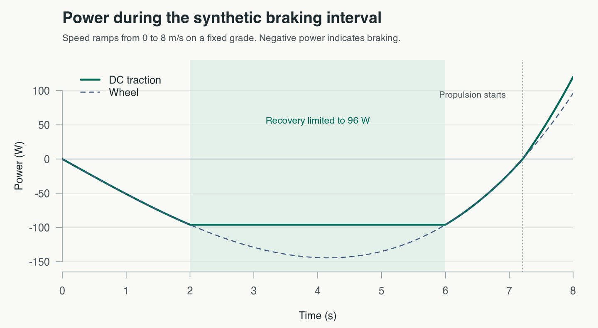

# Continuous drive-cycle energy

Each interval describes the vehicle speed at its start and end. Acceleration
is constant within the interval, and grade, wind and plane-of-array irradiance
are held constant. Adjacent intervals share a boundary speed. This lets a
speed trace represent a launch, changing speed, braking, and time at rest.

## Equations

Let `s` be along-road distance, `v` the ground speed, `w` the signed
headwind and `θ = atan(grade)`. Effective drag area is `Cd A`. The
wheel must supply the acceleration force and balance the road loads.
Similar force balances are used in drive-cycle analysis.
[NREL road-load derivation](https://www.nrel.gov/docs/fy17osti/64610.pdf)

```math
\begin{aligned}
\dot{s}&=v, &\dot{v}&=a=(v_1-v_0)/\Delta t, \\
F_{\mathrm{wheel}}&=ma+mg\left(C_{rr}\cos\theta+\sin\theta\right)
  +\tfrac12\rho C_d A(v+w)|v+w|, \\
\dot{E}_{\mathrm{wheel}}&=P_{\mathrm{wheel}}=vF_{\mathrm{wheel}}.
\end{aligned}
```

The electrical side applies separate propulsion and regeneration efficiencies.
`P_max` caps recovered power at the DC bus. Negative net DC energy means
the cycle delivered more energy than it drew.

```math
P_{\mathrm{traction}} =
\begin{cases}
P_{\mathrm{wheel}}/\eta_{\mathrm{drive}} & P_{\mathrm{wheel}}\geq 0, \\
\max(\eta_{\mathrm{regen}}P_{\mathrm{wheel}},-P_{\max}) & P_{\mathrm{wheel}}<0,
\end{cases}
\qquad
\dot{E}_{\mathrm{DC}} =
P_{\mathrm{traction}}+P_{\mathrm{aux}}-P_{\mathrm{solar}}.
```

Power in watts integrated over seconds gives joules. The API reports all
energy fields in watt-hours and distance in metres.

## Integration

On a speed ramp, wheel power as a function of speed is cubic on either side
of zero relative airspeed. The solver finds the stationary points of wheel
power and splits the speed range into monotone brackets. It then bisects
the brackets that cross zero wheel power or the regenerative power cap.
An interior cap crossing can be detected even when neither endpoint is
capped.

Each resulting interval has a traction-power curve that is cubic or constant.
Two-point Gauss–Legendre quadrature integrates those polynomials exactly in
exact arithmetic. Floating-point evaluation and numerical root location
determine the remaining error. Constant speed is integrated directly.
[NIST Digital Library of Mathematical Functions, Gaussian quadrature](https://dlmf.nist.gov/3.5#v)

## Validation

Unit tests check kinetic-energy conservation during a lossless mechanical
launch and stop, agreement with the segment model at steady speed, signed
drag through a tailwind crossover, and the following braking example.

In the synthetic braking example, wheel power is `v³ − 52v` watts as
speed ramps from 0 to 8 m/s over 8 seconds. Recovery clips at 96 W between
2 and 6 m/s, and propulsion starts at `√52` m/s. Integrating across
those boundaries gives **−503 J** of signed DC traction energy.



The C++ result agreed with that closed form within `5.6 × 10⁻¹⁷ Wh` on
Apple Clang 17. A separate fixed-step midpoint calculation converges as
the sampling grid is refined.

| Midpoint substeps | Absolute traction error |
| ---: | ---: |
| 4 | 6.944 × 10⁻³ Wh |
| 16 | 4.666 × 10⁻⁴ Wh |
| 64 | 2.441 × 10⁻⁵ Wh |
| 256 | 1.397 × 10⁻⁶ Wh |
| 1,024 | 7.427 × 10⁻⁸ Wh |

```sh
python -m pip install .
python examples/validate_drive_cycle.py
```

To redraw the power trace with base R, export the independent reference
curve first.

```sh
python examples/validate_drive_cycle.py --power-csv /tmp/ecm-drive-cycle.csv
Rscript --vanilla examples/plot_drive_cycle.R /tmp/ecm-drive-cycle.csv docs/drive-cycle-power.png
```

This is a prescribed-speed energy model with fixed drivetrain efficiencies.
The caller supplies a feasible speed trace and applies battery storage limits.
Real-fleet accuracy requires measured inputs and comparison against actual
energy use. The analytic checks validate the solver under its stated equations.
